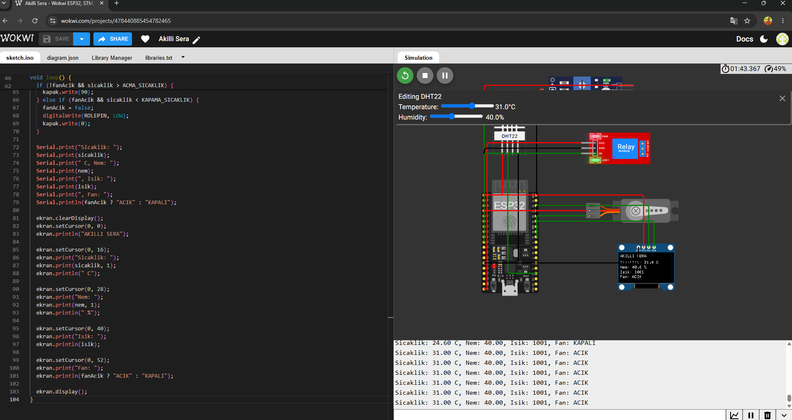

# Akıllı Sera İklim Kontrol Sistemi (ESP32)

Sıcaklık, nem ve ışık değerlerini okuyup havalandırmayı otomatik kontrol eden gömülü sistem projesi. Wokwi simülatöründe geliştirildi.

## Özellikler
- DHT22 ile sıcaklık ve nem ölçümü
- LDR ile ışık seviyesi ölçümü
- Histerezisli fan kontrolü (28 °C'de açılır, 26 °C'de kapanır)
- Servo ile havalandırma kapağı
- SSD1306 OLED ekranda canlı değerler
- `delay()` yerine `millis()` ile bloklamayan döngü

## Kullanılan teknolojiler
ESP32, C++ (Arduino), I2C, Wokwi

## Simülasyon
[Wokwi'de aç](https://wokwi.com/projects/478440885454782465)

## Ekran görüntüleri
Fan kapalı (düşük sıcaklık):

Fan açık (yüksek sıcaklık):

